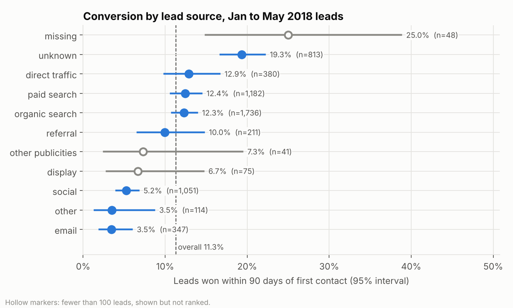
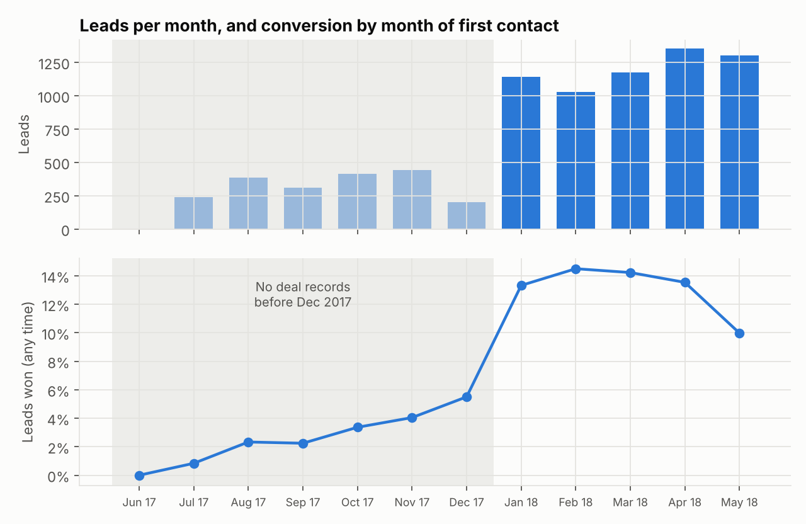
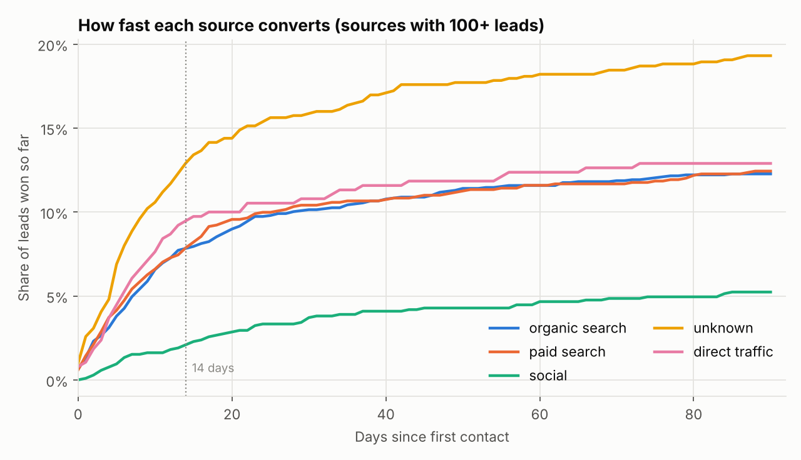
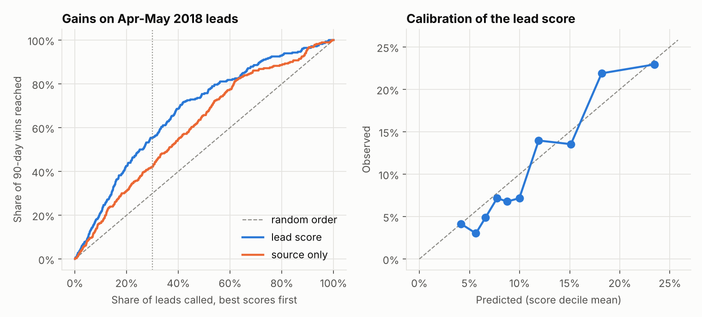
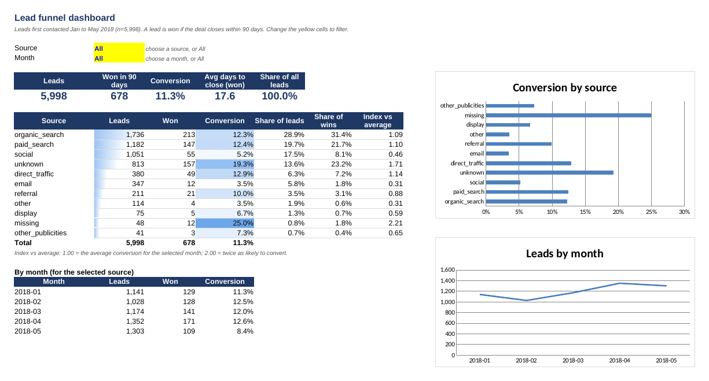
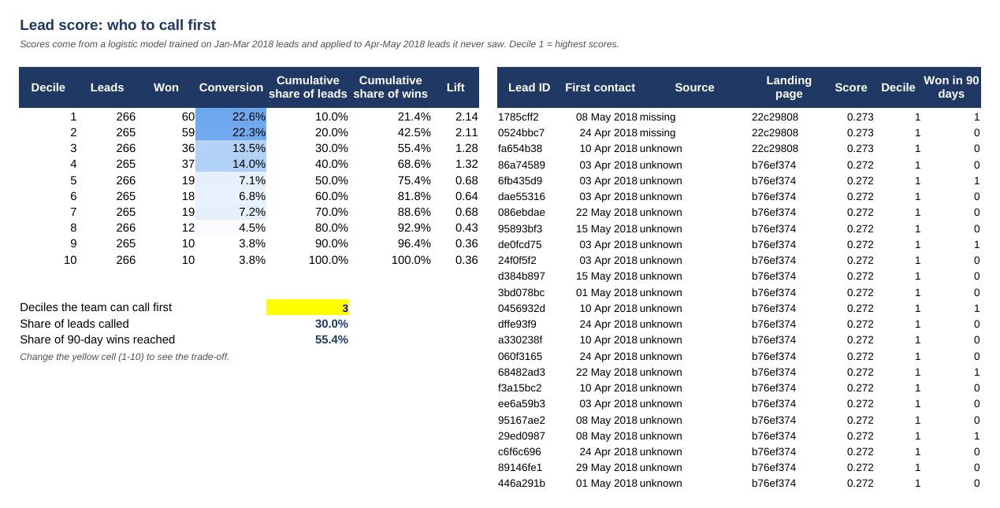
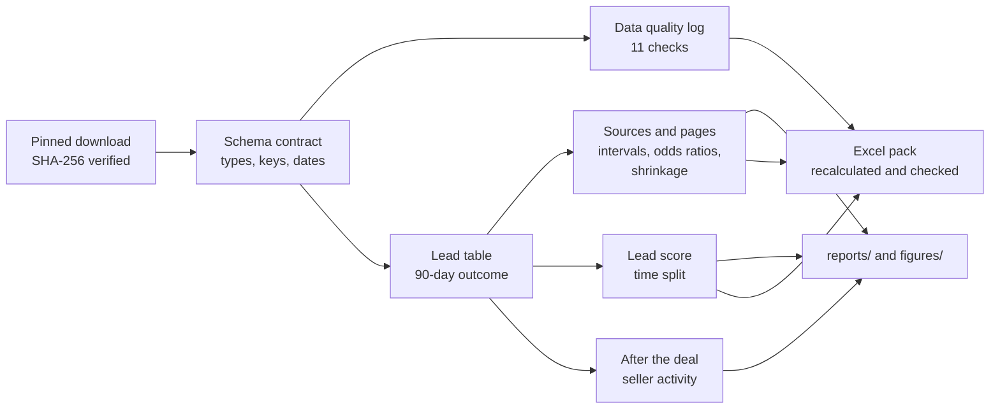

# B2B Lead Funnel Analytics

**Which marketing sources bring leads that actually close? How fast do they close? Which new leads should the sales team call first? And do the customers won go on to trade?**

[](https://github.com/gbadedata/b2b-lead-funnel-analytics/actions/workflows/ci.yml)


This is an end-to-end analysis of a real B2B sales funnel: 8,000 inbound leads, the 842 deals the sales team closed, and the orders those new customers placed afterwards. It covers the questions any business that sells through enquiries and a sales team needs answered, such as brokers, agencies, marketplaces and B2B services. The deliverables are what a manager would use: a data quality log addressed to the data owner, a lead score tested on months it never saw, and an Excel dashboard that runs on live formulas.

<p align="center"></p>

## Contents

- [Results at a glance](#results-at-a-glance)
- [Key findings](#key-findings)
- [What I would recommend](#what-i-would-recommend)
- [The Excel reporting pack](#the-excel-reporting-pack)
- [How it works](#how-it-works)
- [Mistakes this analysis is built to avoid](#mistakes-this-analysis-is-built-to-avoid)
- [Reproduce it](#reproduce-it)
- [Limitations](#limitations)
- [Data and licence](#data-and-licence)

## Results at a glance

All conversion figures use leads first contacted from January to May 2018: 5,998 leads, of which 11.3% were won within 90 days.

| Question | Answer | Evidence |
|---|---|---|
| Which sources convert best? | Leads with **no recorded source**: 19.6%, against 9.9% for leads with a source | Odds ratio 1.70 (95% CI 1.36 to 2.14) vs organic search, adjusted for month; Holm-significant |
| Which sources underperform? | **Social** (5.2%) and **email** (3.5%) | Odds ratios 0.39 and 0.26; both Holm-significant |
| How fast do deals close? | Median **10 days**; 63% of 90-day wins close within 14 days | Speed table and cumulative conversion curves |
| Can we pick the best leads up front? | Calling the top 30% of scored leads reaches **55% of wins** | ROC AUC 0.696 (0.664 to 0.729) vs 0.624 for source alone, on months the model never saw |
| What drives the score? | **Landing page** | Without page features, AUC drops to 0.640 |
| Do won customers trade? | 43.6% made a sale within 90 days (a lower bound) | Paid search 54.2% vs organic 40.5% |

## Key findings

**1. Leads from before December 2017 can't be used to measure conversion.** The first deal on record is dated 5 December 2017, but leads go back to June 2017. Leads from 2017 show 3.0% conversion, against 13.0% for 2018 leads. Any trend or channel comparison that includes 2017 would be distorted, so the analysis cohort starts in January 2018. ([DQ01](reports/DATA_QUALITY.md))

<p align="center"></p>

**2. The best-converting leads have no recorded source.** Leads marked "unknown" or left blank are 14.4% of the cohort but 24.9% of wins. Marketing spend can't be credited for the most valuable leads until source is captured. These may be phone or manual entries, which would explain the high conversion, but the data can't confirm that.

**3. Social and email bring volume, not deals.** Social is 17.5% of leads but 8.1% of wins. Paid search, organic search and direct traffic all convert at about 12 to 13% and can't be told apart statistically.

**4. Most deals close within two weeks.** Social is the slowest source, with a median of 18 days to close.

<p align="center"></p>

**5. A simple lead score beats sorting by source, and landing page is why.** A logistic model uses only what is known when the enquiry arrives (source, landing page and weekday). It is trained on January to March and tested once on April and May. Gradient boosting was tried and did not beat it (AUC 0.677), so the simpler model is kept.

<p align="center"></p>

**6. Raw landing-page rankings are noise.** Of 407 pages, 328 had fewer than 10 leads, so a naive ranking is topped by pages with one lead and a 100% "rate". After beta-binomial shrinkage, the two busiest pages convert at about 20%. The third busiest, page `58326e62`, converts at 4.4% from 495 leads. ([figure](figures/03_landing_page_shrinkage.png))

**7. Conversion isn't the whole story.** Of 621 won sellers with a full 90-day window, sellers won through paid search were the most likely to start selling. Sellers with no recorded source produced 38.1% of the sales value. Sellers classed as "online big" were 15% of deals but 52.5% of sales value. ([figure](figures/06_post_deal_activation.png))

## What I would recommend

1. **Make lead source a required field**, and find out how "unknown" leads are created.
2. **Judge social and email on deals won**, not leads generated.
3. **Order callbacks by lead score**, and focus follow-up on a lead's first two weeks.
4. **Record the sales rep on every lead**, not only on won deals. At present, rep conversion rates can't be measured. ([DQ03](reports/DATA_QUALITY.md))
5. **Audit landing page `58326e62`**: it brings a lot of leads that rarely convert.

## The Excel reporting pack

[`outputs/lead_funnel_pack.xlsx`](outputs/lead_funnel_pack.xlsx) is built by the pipeline and recalculated in LibreOffice, so it opens with every value computed. A manager can filter it, or paste in next month's leads, without touching Python.

<p align="center"></p>

- **Dashboard:** KPIs, a source table and monthly trend, built from `COUNTIFS`, `SUMIFS` and `AVERAGEIFS` over the Leads sheet. Source and month dropdowns filter every number, and the "All" option works through a wildcard criteria cell. Conditional formatting and charts update with the filters.
- **Lead_Scoring:** score deciles with cumulative gains and lift. Set how many deciles the team can call, and the sheet shows the share of leads called and the share of wins reached.
- **Channel_Stats, Landing_Pages:** the statistical outputs (intervals, adjusted odds ratios, shrinkage), labelled as static values.
- **Data_Quality:** the issue log, colour-coded by severity.

<p align="center"></p>

The workbook has 153 formulas and zero errors. A test rebuilds it, recalculates it in LibreOffice and checks the results against pandas.

## How it works



| Step | Method |
|---|---|
| Cohort and outcome | Leads first contacted 1 Jan to 31 May 2018. A lead counts as won if the deal closes within 90 days. Deal data runs to November 2018, so every lead has at least 167 days of follow-up and no censoring adjustment is needed. |
| Source comparison | Wilson 95% intervals and a chi-square test. Logistic regression with contact-month fixed effects, compared against organic search, with Holm-adjusted p-values. Sources with fewer than 100 leads are shown but not ranked. |
| Landing pages | Beta-binomial empirical Bayes: the prior is fitted by maximum marginal likelihood, giving posterior means with 90% credible intervals. |
| Lead score | Uses first-contact features only. Landing pages are target-encoded out-of-fold with smoothing, and unseen pages fall back to the prior. Sparse sources are pooled. The score is evaluated on ROC AUC, PR AUC, Brier score, log loss, gains and calibration, with a bootstrap CI for the gain over a source-only ranking. |
| After the deal | Non-cancelled orders in the 90 days after the won date. Restricted to deals won by 1 June 2018, because order data thins out after August 2018. |

The full tables are in [reports/RESULTS.md](reports/RESULTS.md), which is generated by the pipeline.

## Mistakes this analysis is built to avoid

| Mistake | What it would do | What this repo does |
|---|---|---|
| Including leads from before deal tracking began | Makes conversion look about 4x lower in 2017 | Cohort starts January 2018 (DQ01) |
| Comparing recent and older leads on "won so far" | Recent leads look worse because they've had less time to close | Fixed 90-day window, fully observed for every lead |
| Ranking tiny groups | 1-lead pages top the table at 100% | Shrinkage for pages; no ranking for sources under 100 leads |
| Testing many channels at once | False positives | Holm correction across 10 comparisons |
| Ignoring the month mix | A channel gets credit for a strong month | Month fixed effects in the odds-ratio model |
| Target leakage in the score | Inflated accuracy | First-contact features only, out-of-fold encoding, time split |
| Picking the model on the test set | Over-optimistic score | Logistic declared as the main model; boosting reported as a comparison |
| Judging channels on conversion alone | Rewards deals that never trade | Post-deal seller activity and value |
| Spreadsheet formulas that are silently wrong | Wrong numbers in front of a manager | Workbook recalculated and compared with pandas in tests |

## Reproduce it

```bash
git clone https://github.com/gbadedata/b2b-lead-funnel-analytics
cd b2b-lead-funnel-analytics
make install   # pip install -e ".[dev]"
make data      # download from a pinned mirror commit and verify SHA-256 checksums
make run       # about 15 seconds: writes reports/, figures/, outputs/
make test      # 27 tests on synthetic data, no network needed
```

This needs Python 3.11 or later. LibreOffice (`soffice`) is optional: without it, the workbook is written but not recalculated. Seeds are fixed, and in testing a fresh clone reproduced the committed `reports/results.json` exactly.

| Output | What it is |
|---|---|
| [`reports/RESULTS.md`](reports/RESULTS.md) | Every table behind the findings |
| [`reports/DATA_QUALITY.md`](reports/DATA_QUALITY.md) | 11 issues, each with finding, impact and fix |
| `reports/results.json` | Machine-readable results |
| `outputs/lead_funnel_pack.xlsx` | Excel reporting pack |
| `outputs/lead_scores_apr_may_2018.csv` | Test-period leads with scores and deciles |
| `figures/` | Six charts used above |

<details>
<summary>Repository layout</summary>

```
src/leadfunnel/
  config.py        dates, windows and thresholds in one place
  download.py      pinned download with checksum verification
  load.py          schema contract
  quality.py       data quality checks and the issue log
  funnel.py        cohort, conversion, intervals, odds ratios, shrinkage, speed
  scoring.py       time-split lead score with leakage-safe target encoding
  deal_quality.py  post-deal seller activity and value
  excel_pack.py    formula-driven reporting workbook
  recalc.py        LibreOffice recalculation and formula error check
  figures.py       charts
  report.py        results.json and generated markdown
  pipeline.py      end-to-end run
tests/             synthetic fixtures: contract, quality, funnel maths, scoring, workbook
scripts/           README preview renderer
```
</details>

<details>
<summary>What the tests cover</summary>

- **Schema contract:** missing columns, duplicate leads, orphan deals and bad dates all stop the run.
- **Funnel maths:** the 90-day window boundary (day 90 counts, day 91 doesn't), deals dated before first contact, Wilson interval known values, Holm against a hand calculation, shrinkage behaviour, and monotone cumulative curves.
- **Scoring:** no overlap between train and test periods, and target encoding never sees a lead's own outcome. Unseen pages fall back to the prior, and only first-contact features are used.
- **After the deal:** window edges and exclusion of cancelled orders.
- **Workbook:** structure, no functions LibreOffice can't evaluate, and formula results equal to pandas after recalculation.
</details>

## Limitations

- **Activation is a lower bound.** The public order file holds about 100,000 orders and may not include every order; 463 of the 842 won sellers have no order in it. Comparing sources assumes the sample isn't related to lead source.
- **No costs.** The data has no spend figures, so sources are ranked on conversion and value, not on cost per deal.
- **Associations, not causes.** A page may convert well because of the audience it attracts rather than its design. Showing cause would need an A/B test.
- **One test window.** The lead score was tested on two months; check it again on newer leads before relying on it.
- **A marketplace, not every business.** The leads are businesses applying to sell on an e-commerce marketplace, so the method transfers to other inbound-led businesses, but the numbers don't.

## Data and licence

The data is the Olist [Marketing Funnel](https://www.kaggle.com/datasets/olistbr/marketing-funnel-olist) and [Brazilian E-Commerce](https://www.kaggle.com/datasets/olistbr/brazilian-ecommerce) datasets, licensed CC BY-NC-SA 4.0. It is downloaded at run time from a pinned commit of a public GitHub mirror and checked against the SHA-256 hashes in [`data/sources.json`](data/sources.json). The funnel files were cross-checked byte for byte against a second mirror. No raw data is stored in this repository.

The code is MIT licensed.

---

Built by **Oluwagbade Odimayo**, data scientist: [gbadedata.com](https://gbadedata.com) · [GitHub](https://github.com/gbadedata) · [LinkedIn](https://www.linkedin.com/in/oluwagbade-odimayo-)
